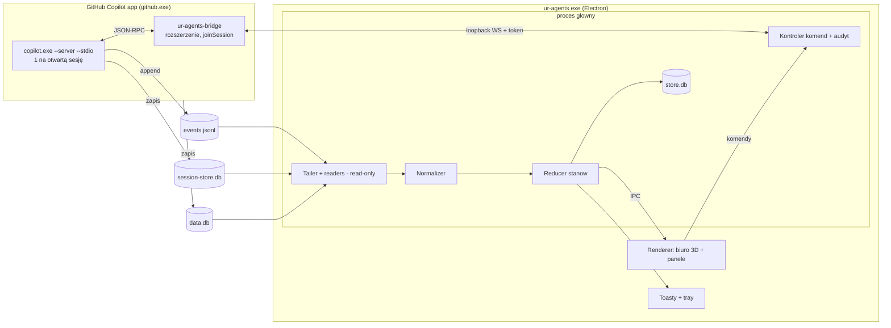

# ur-agents — plan (v3)

**Cel:** osobna aplikacja **.exe** — „biuro agentów" w **3D**. Każdy agent z GitHub Copilot app to **urocza figurka-robocik 3D (styl zabawki z vinylu/plastiku, jak na Twoich referencjach) przy biurku**, w swoim prostokącie (strefie na podłodze). Wygląd zależy od rodziny modelu: **Claude = pomarańczowy klockowaty stworek, GPT = ciemny robocik z ekranem-twarzą i świecącymi oczami, reszta (Gemini, Grok…) = kolejne figurki w tym samym stylu**, każda z własną sylwetką i kolorem. Po animacji widzisz, co robi; po kliknięciu dostajesz **panel z pełnymi informacjami** i podglądem na żywo — i możesz agentem **sterować** (wysłać wiadomość, zatrzymać, zatwierdzić uprawnienie, odpowiedzieć na pytanie).

Stan: v3 · 2026-10-18 · zbadane na: app 1.1.30, CLI 1.0.99-2, Windows.
Zmiany vs v2: **grafika 3D** (zamiast pixel-artu) i **sterowanie w zakresie** (przez oficjalne rozszerzenie-most). v3.1: **styl postaci wg Twoich referencji** (chunky figurki-robociki zamiast humanoidów).

Aktualizacja 2026-10-21: ur-agents obsługuje wyłącznie sesje GitHub Copilot.

---

## 1. Skąd bierzemy dane (zweryfikowane na Twojej maszynie)

`github.exe` (Tauri) uruchamia po jednym `copilot.exe --server --stdio` na otwartą sesję (JSON-RPC po stdio). Wszystko, co agenci robią, **ląduje na dysku** — czytamy to bez ingerencji:

| | Źródło | Co daje | Uwagi |
|---|---|---|---|
| **S1** | `~/.copilot/session-state/<sid>/events.jsonl` | wiadomości, `tool.execution_*`, `permission.*`, `subagent.*`, `session.*`, usage | append-only, 47 typów. Sub-agent = `agentId` w kopercie. **Brak delt tokenów.** Plik ma tylko 61 z 1364 katalogów → własne archiwum. ~45% zdarzeń to `hook.*` (szum). |
| **S2** | `~/.copilot/data.db` (SQLite, WAL) | `sessions.is_running`, tokeny, kontekst, `model`; `workspaces` (branch, PR, diff); `activity_items`; `workspace_parent_links` | schemat wewnętrzny, migrowany przy każdym release. **Zawiera tokeny dostępu — nigdy ich nie czytamy.** |
| **S3** | `~/.copilot/session-store.db` | `assistant_usage_events` (model, tokeny, nano-AIU, TTFT, `agent_id`); FTS | koszty i latencja |
| **S4** | `session-state/<sid>/session.db` | `todos`, `workflow_*` | plan / postęp agenta |
| **S5** | `inuse.<pid>.lock` + procesy | żywotność | 4 procesy CLI żyją, `is_running`=1 ma jedna sesja → *proces żyje ≠ agent pracuje* |
| **S8** | **most (rozszerzenie CLI)** — sekcja 5 | zdarzenia sesji na żywo (`session.on`) **+ sterowanie** | oficjalne SDK (`joinSession`); do sprawdzenia, czy `session.on` daje delty tokenów |
| S6 | OpenTelemetry CLI | spany modelu i narzędzi | opcjonalne, env przed startem apki |
| ✗ | prywatny WS apki (`run/ws.port`+token) | — | **odrzucone** na rzecz S8 (oficjalne, wersjonowane SDK) |
| ✗ | proxy MITM HTTPS | surowy ruch | odrzucone: własny certyfikat + wgląd w token Copilota |

**Pomiary:** 1,6 GB eventów (mediana 3,7 MB, max 278 MB) → nigdy nie parsujemy całych plików. `node:sqlite` czyta żywe bazy `readOnly` w ~0,3 s. W historii ≥6 wersji CLI → parser tolerancyjny.

**Rodzina modelu:** z `sessions.model` / `session.start.selectedModel` / `subagent.started.model` (np. `claude-sonnet-5.5`, `gpt-6-astra`, `gemini-4-argon`, `grok-4.7`, `mai-code-1.1-flash`). Rozpoznanie po prefiksie; nieznany → „generic robot". Sub-agent może mieć inny model niż rodzic.

---

## 2. Założenia (zmień, jeśli się mylę)

1. **Obserwacja + sterowanie** (sterowanie przez most S8, domyślnie **wyłączone** i włączane per sesja/globalnie w ustawieniach).
2. Forma: **samodzielna aplikacja desktop `.exe`**.
3. Stack: **Electron + TypeScript** (na maszynie jest Node, **nie ma Rusta** → Tauri odpada bez instalacji toolchainu; demon działa w procesie głównym). Do sprawdzenia w Fazie 0: Node w Electronie wspiera `node:sqlite` (≥22.5), inaczej `better-sqlite3`.
4. Grafika: **3D — Three.js** (react-three-fiber). Postacie to proste, zaokrąglone bryły, więc prototyp powstaje **proceduralnie w kodzie**, docelowo modele **glTF**; panele w React/HTML.
5. Zakres: lokalne sesje GitHub Copilot.
6. Historia we własnej bazie (`%LOCALAPPDATA%\ur-agents\`), retencja 30 dni, wyłączalna.
7. Styl wg Twoich referencji (pomarańczowy klockowaty stworek; ciemny robocik z ekranem-twarzą, cyjanowymi oczami i słuchawkami). Postacie to **własne projekty** „w klimacie" rodziny, **bez logotypów** firm i bez kopiowania 1:1 cudzych maskotek (znaki towarowe, gdyby repo było publiczne). Założenie: ref. #1 = Claude, ref. #2 = GPT.
8. Żadnych prawdziwych danych sesji w repo.

---

## 3. Architektura

ur-agents odczytuje lokalne dane sesji GitHub Copilot i uruchamia agenty przez Copilot CLI. Wybór sesji otwiera jej dokładną trasę w GitHub Copilot. Inni dostawcy nie są obsługiwani.

Zasady:

- **Czytanie jest read-only:** bazy `readOnly`; zapytania tylko z rejestru (allowlista tabel/kolumn); nigdy `accounts`, `settings`, `run/*.token`, `mcp-config.json`.
- **Tail, nie parse:** kursor per plik `{plik, rozmiar, offset}`, tylko pełne linie; rewrite po `rozmiar < offset`. `parentId` **nie** jest liniowym łańcuchem.
- **Zimny start:** stan odtwarzany z ogona pliku (≤4 MB wstecz); reszta — backfill w tle (worker).
- **Duże payloady:** wyniki narzędzi >64 KB → head+tail; `encryptedContent`/`reasoningOpaque` pomijamy; `session.binary_asset` leniwie.
- **Rdzeń bez I/O** (`core`: parser, reducer, redaktor sekretów, protokół komend) + `app` (Electron) + `ui` (3D + panele) + `bridge` (rozszerzenie). Rdzeń testowany na nagraniach.
- **Symulator:** `--copilot-home <katalog>` + `ur sim` odgrywa syntetyczne sesje (także komendy sterujące) → rozwój animacji i testy bez żywych agentów.
- **Renderer** nie dostaje surowych danych z dysku — tylko znormalizowane, zredagowane zdarzenia przez IPC (`contextIsolation`, bez `nodeIntegration`).

---

## 4. Stany agenta → animacje 3D

Stan wyprowadzamy ze zdarzeń; **każdy stan ma własny klip animacji i dymek z tekstem** (nigdy sam obraz). Figurki nie mają mimiki — emocje niosą **oczy** (kształt, kolor, mruganie) i poza ciała (squash & stretch). „Postać robi…" poniżej czytaj jako uproszczone ruchy rączek/korpusu.

| Stan | Reguła | Postać robi… |
|---|---|---|
| offline | brak żywego PID i otwartej tury | puste krzesło, wygaszona lampka |
| idle | proces żyje, brak otwartej tury | drzemie (zzz) |
| thinking | `assistant.turn_start` bez `turn_end`, brak narzędzi | podpiera głowę, bąbel „…" |
| tool: shell | `powershell`, `read_powershell` | stuka w laptopa, w dymku komenda |
| tool: czytanie | `view`, `rg`, `grep`, `glob` | przegląda papiery / lupa |
| tool: pisanie | `edit`, `apply_patch`, `create` | pisze, lecą kartki |
| tool: sieć | `web_fetch`, `web_search` | kręci globusem / telefon |
| tool: task | `task` → `subagent.started` | obok siada **mała postać sub-agenta** |
| awaiting-input | w toku `ask_user` ∪ `agent_asking` | **podnosi rękę**, „!" nad głową |
| awaiting-permission | `permission.requested` bez `completed` | trzyma tabliczkę „OK?" |
| compacting | `compaction_start` bez `complete` | pakuje kartony |
| error | `session.error`, `subagent.failed` | dym, czerwona lampka |
| aborted / done | `abort` / `session.task_complete` | wzrusza ramionami / pije kawę |
| stalled | otwarta tura + martwy PID lub cisza > N min | pajęczyna, zamrożony |

- **Sub-agenci:** zdarzenia z `agentId` należą do sub-agenta ze `subagent.started` (`agentDisplayName`, model, `executionMode`, `toolCallId`). Mniejsze postacie przy biurku rodzica, z wyglądem wg własnego modelu.
- **Relacje między sesjami:** `external_tool.requested` (`create_session`, `send_session_message`) + `workspace_parent_links` → papierowy samolocik między biurkami.
- **Koszt/kontekst:** `session.usage_checkpoint`, `session_context_usage`, `compaction_*` → „kubek kawy" przy biurku (pełniejszy kontekst = bardziej zmęczona postać).

---

## 5. Sterowanie agentami (most)

**Jak:** małe rozszerzenie CLI `ur-agents-bridge` (user-scope: `~/.copilot/extensions/ur-agents-bridge/extension.mjs`) ładuje się w **każdej** sesji (CLI forkuje je jako proces Node, `joinSession()` daje dostęp do jej API). Most łączy się z `ur-agents.exe` po **loopback WebSocket + token** i wykonuje komendy. To oficjalna droga z SDK — nie hackujemy prywatnych protokołów apki.

**Co SDK udostępnia (zweryfikowane w dokumentacji i `.d.ts`):**

| Komenda | API | Uwagi |
|---|---|---|
| Wyślij wiadomość do agenta | `session.send({prompt, attachments})` | wstrzykuje nową wiadomość użytkownika; do sprawdzenia: kolejka vs natychmiast |
| Zatrzymaj (abort) | `session.abort()` | przerywa bieżącą turę |
| Odpowiedz na pytanie agenta | `session.rpc.ui.handlePendingUserInput` | dla `ask_user` |
| Zatwierdź / odrzuć uprawnienie | `session.rpc.permissions.handlePendingPermissionRequest` | pokazujemy rodzaj (`read`/`write`/`shell`…) i pełną komendę |
| Zmień model | `session.setModel(model, {reasoningEffort})` | |
| Zmień tryb uprawnień | `session.rpc.permissions.setMode` | |
| Zdarzenia na żywo | `session.on(type, handler)` | **spike:** czy dochodzą ephemeralne delty wiadomości (wtedy „live" jest per token) |

**Zasady bezpieczeństwa sterowania:**

- **Domyślnie tylko obserwacja** — sterowanie włączane osobnym przełącznikiem (globalnie i per sesja).
- Kanał **tylko `127.0.0.1`**, losowy sekret zapisany w `%LOCALAPPDATA%\ur-agents\` (ACL tylko użytkownik); most odrzuca połączenia bez sekretu i z innych procesów niż `ur-agents.exe` (weryfikacja klienta).
- **Zatwierdzanie uprawnień wymaga świadomego kliknięcia** w panelu (pokazujemy pełną komendę/ścieżkę); **żadnego auto-approve** w v1. Zatwierdzenia `shell`/`write` dodatkowo oznaczone jako ryzykowne.
- **Dziennik audytu** każdej komendy (kto/kiedy/sesja/treść), lokalnie.
- Most jest **minimalny** (kilkadziesiąt linii, zero zależności, zero sieci poza loopback) — kod działający w każdej sesji.
- Most nie loguje na `stdout` (to JSON-RPC) — tylko `session.log` / plik logu.

**Ograniczenia do zbadania w Fazie 0:**

- Most ładuje się przy starcie sesji / po `extensions_reload` — **już otwarte sesje** wymagają reloadu; sesje bez mostu są w trybie „tylko podgląd" (oznaczone na kafelku).
- **Wyścig z UI apki:** to samo uprawnienie/pytanie może być jednocześnie widoczne w oknie Copilot app — sprawdzić, kto „wygrywa" i jak obsłużyć już rozstrzygnięte żądanie.
- Czy rozszerzenie user-scope jest ładowane w sesjach tworzonych przez apkę (log potwierdza „Installed 1 native extension(s) for session …" i ładowanie wtyczki mobile-canvas, więc mechanizm w apce działa).
- Instalacja mostu: przez `extensions_manage`/kopiowanie pliku z `.exe`; odinstalowanie = usunięcie katalogu.

---

## 6. UX i grafika 3D — brief

**Tryb:** połączenie *Operate* (czytelność, szybkość, wielu agentów) i *Experience* (świat 3D to sedno). Klimat nie może zabić czytelności.

**Sukces:** rzut oka na okno mówi, kto pracuje, kto czeka na Ciebie, kto się wywalił; klik w postać daje pełne dane i sterowanie.

### Scena „biuro"
- **Jedna wspólna scena 3D** (nie osobne canvasy): podłoga z **prostokątnymi strefami** (jedna na sesję — to Twoje „prostokąciki"), w każdej biurko, krzesło, laptop, lampka, tabliczka z tytułem sesji i postać. Siatka układa się automatycznie (1–30 stref).
- **Kamera:** domyślnie z góry pod kątem (widać wszystkie strefy), płynny najazd na klikniętą postać, obrót/zoom myszą, przycisk „widok całości".
- **Etykiety** (tytuł, stan, bieżąca czynność `powershell: npm test · 42 s`, model, koszt) jako HTML-overlay/billboardy — zawsze czytelny tekst.
- **Wygląd wg rodziny:** patrz tabela „Rodziny postaci" niżej; w rodzinie wariant wg poziomu modelu (np. opus > sonnet > haiku — akcesorium/rozmiar). Nazwa modelu zawsze też tekstem.
- **Sortowanie/układ:** „Needs me" bliżej kamery / podświetlone; filtr po projekcie/branchu; ukryj offline.
- **Alerty:** toast + tray, gdy agent czegoś od Ciebie potrzebuje (także przy zminimalizowanym oknie).
- **Tryb dostępny/niskiej wydajności:** przełącznik na **listę 2D** (ta sama funkcjonalność, czytniki ekranu, słaby GPU) oraz statyczne pozy przy `prefers-reduced-motion`.

### Po kliknięciu — panel agenta
1. **Live:** oś czasu — tury, wiadomości, narzędzia (start/complete, czas, wynik), uprawnienia inline, sub-agenci jako rozwijane pasy; *Follow / Pause / Skocz do teraz*; `hook.*` zwinięte.
2. **Info:** model + rodzina, tryb, projekt, branch/worktree, PR, czas pracy, koszt, tokeny, kontekst, kompaktacje, TTFT.
3. **Sterowanie** (jeśli most aktywny): pole „wyślij wiadomość", **Stop**, odpowiedź na `ask_user`, **Zatwierdź/Odrzuć** uprawnienie, zmiana modelu/trybu — z potwierdzeniami i śladem w audycie.
4. **Todos/plan**, **zmienione pliki + diff**, **drzewo sub-agentów**, **Replay** zakończonej sesji.
5. Renderery narzędzi wg realnych danych: `powershell`/`read_powershell`, `view`/`rg`/`grep`/`glob`, `apply_patch`/`edit`/`create` (diff), `task`, `sql`, `ask_user`, `web_*`, `invoke_canvas_action`, fallback JSON.

### Modele i animacje 3D
- **Styl (wg referencji):** chunky, zabawkowe figurki — zaokrąglone bryły, duże „ciało-głowa", malutkie rączki i nóżki, bez palców i drobnych detali; twarz to dwa oczy (czarne prostokąty albo świecący ekran). Czytelne z daleka, tanie w renderze.
- **Jeden prosty wspólny rig** (korpus + 2 ręce + 2 nogi + oczy + slot na akcesorium) i ~14 klipów (tabela w sekcji 4) współdzielone przez wszystkie rodziny; rodziny różnią się **bryłą, kolorem, materiałem i akcesoriami**.

**Rodziny postaci** (własne projekty wg referencji):

| Rodzina | Rozpoznanie | Projekt |
|---|---|---|
| Claude | `claude-*` | pomarańczowy klockowaty stworek, dwa czarne prostokątne oczy, boczne „łapki", krótkie nóżki (ref. #1) |
| GPT | `gpt-*` | ciemny zaokrąglony robocik z ekranem-twarzą, cyjanowe oczy, słuchawki (ref. #2) |
| Gemini | `gemini-*` | ten sam styl: błękitno-fioletowy, okrągłe „bańki"-oczy, dwuczęściowa głowa |
| Grok | `grok-*` | grafitowo-czarny minimalista, ukośny wizjer zamiast oczu, antenka |
| MAI | `mai-*` | jasny, własna paleta (opcjonalnie) |
| generic | pozostałe | neutralny szary robocik |
- Docelowy format **glTF/GLB**. Rekwizyty (laptop, papiery, globus, kartony, tabliczki, kubek) jako osobne meshe/instancje. Oczy jako emisyjne płaszczyzny z teksturą/shaderem (zmiana wyrazu = zmiana tekstury).
- **Wydajność:** instancjonowanie rekwizytów, GPU skinning, współdzielone materiały, animacje pauzowane poza kadrem lub gdy okno ukryte; cel 60 fps przy 30 postaciach na zintegrowanym GPU.
- **Skąd modele:** bryły są proste, więc **prototyp w całości proceduralnie w kodzie** (RoundedBox + materiały + emisyjne oczy; animacje jako transformacje i squash-stretch) — zero zależności od assetów i licencji, warianty rodzin to parametry. Docelowo: własne modele z Blendera → GLB lub generowane narzędziem 3D + ręczne czyszczenie. Zewnętrzne assety (np. rekwizyty biurowe) tylko z jasną licencją, lista w `docs/assets.md`.
- Świat wizualny (paleta, światło, ton biura) dobieramy przez `/impeccable init` → `new-work` (najpierw PRODUCT.md); po UI — detektor `detect.mjs` na panelach.

**Stany do zaprojektowania:** pierwsze uruchomienie (brak `~/.copilot` / apka nie działa), puste biuro, backfill w toku, degradacja (nieznane zdarzenia → baner „schema drift"), sesja 100k+ zdarzeń, wynik narzędzia rzędu MB, most nieaktywny (tylko podgląd), odmowa/niepowodzenie komendy, 1–30 stref.

**Granice:** to nie klient czatu (wysyłanie wiadomości jest akcją w panelu, nie głównym widokiem); bez chmury i telemetrii; stan zawsze też tekstem; WCAG AA dla paneli.

---

## 7. Fazy

| Faza | Zakres | Kryterium wyjścia | Rozmiar |
|---|---|---|---|
| **0 Spike** | szkielet repo (npm workspaces: `core`/`app`/`ui`/`bridge`), `docs/data-sources.md`, syntetyczne fixtures. Weryfikacje: `node:sqlite` w Electronie; `ask_user`, `agentId`; **most:** załadowanie w sesji z apki, `session.on` (delty?), `send`/`abort`, wyścig uprawnień z UI apki; **WebGL w Electronie** (FPS na Twoim GPU) | okno Electrona z **jedną postacią 3D** pokazującą na żywo stan tej sesji (S1+S2) <1 s; most wysyła testową wiadomość do jednej sesji | M |
| **1 Rdzeń** | tailer, normalizer (zod, tolerancyjny), reducer stanów, własny store, IPC, protokół komend + audyt; headless `ur ls` | stany poprawne ≤2 s; idle CPU <2%, RSS <300 MB przy 1,6 GB historii; testy „golden" + symulator | M |
| **2 Biuro 3D** | `init` → `new-work`, scena z strefami, postać bazowa + klipy, warianty rodzin, dymki/etykiety, sub-agenci, panel agenta (Live + Info), toasty/tray, lista 2D | 5+ równoległych agentów, 60 fps przy 30 postaciach, klik → najazd kamery + live view sesji 100k zdarzeń bez zacięć | L |
| **3 Sterowanie** | UI komend w panelu, bezpieczny kanał, audyt, potwierdzenia, obsługa wyścigów, stan „most nieaktywny", instalator mostu | wysłanie wiadomości / Stop / odpowiedź / zatwierdzenie z poziomu `.exe` działa na żywych sesjach; audyt kompletny | M |
| **4 Historia** | backfill (worker), Replay, FTS, tabela sesji, graf, wykresy użycia | wyszukiwanie <300 ms po 30 dniach; replay dowolnej zakończonej sesji | M |
| **5 Integracja i hardening** | autostart, tray, instalator/auto-update (`electron-builder`), detektor schema-drift, retencja/purge, testy redakcji, docelowe modele/animacje, chmura przez `gh agent-task`, opcjonalny OTel | działa po aktualizacji apki bez zmian lub z czytelnym ostrzeżeniem | M |

---

## 8. Ryzyka

| Ryzyko | Mitygacja |
|---|---|
| Formaty prywatne się zmieniają (app 1.1.28 → 1.1.30 w 8 dni) | parser tolerancyjny; `pragma table_info`; „golden" fixtures per wersja CLI; tryb zdegradowany z banerem. Krytyczne dane z S1/S8, S2 tylko wzbogaca |
| **Sterowanie = większa powierzchnia ataku** (ktoś/coś mogłoby zatwierdzać uprawnienia lub wysyłać prompty) | domyślnie wyłączone; loopback + sekret + weryfikacja klienta; zatwierdzenia tylko ręcznym kliknięciem; audyt; minimalny most; brak auto-approve |
| Wyścig z UI apki przy uprawnieniach/pytaniach | spike w Fazie 0; idempotentna obsługa „już rozstrzygnięte"; komunikat w UI |
| Most nie działa w już otwartych sesjach / zmiana API SDK | tryb „tylko podgląd" + reload; wersjonowanie protokołu mostu; test na kolejnych wersjach CLI |
| Wyciek danych (rozmowy, output z sekretami) | brak sieci wychodzącej; renderer bez dostępu do dysku/Node, CSP; markdown przez DOMPurify; redaktor sekretów przy ingeście (`ghp_`, `github_pat_`, AWS, JWT, klucze prywatne); nigdy tokeny z `data.db` |
| Konflikt z żywą apką (WAL, blokady) | `readOnly`, krótkie transakcje, `busy_timeout`, bez checkpointów; fallback: kopia plików do temp |
| Skala (1,6 GB, plik 278 MB) | kursory, leniwa hydracja, rzadki indeks offsetów, wirtualizacja panelu, backfill w workerze |
| **3D: wydajność i koszt assetów** | prosty wspólny rig i klipy, instancjonowanie, pauzowanie animacji, lista 2D jako fallback; prototyp proceduralny w kodzie, jedna postać → warianty rodzin |
| Licencje modeli / znaki towarowe | tylko assety o jasnej licencji (`docs/assets.md`); własne projekty bez logotypów firm. Ref. #1 przypomina maskotkę znaną z narzędzi Anthropic — przy publikacji repo zmienić na własny kształt |
| Rozmiar/pamięć Electrona + WebGL | akceptowalne w v1; ewentualna migracja później (rdzeń `core` jest niezależny) |
| Prawdziwe dane w repo | fixtures syntetyczne/zanonimizowane; nagrania w `.gitignore` |

---

## 9. Decyzje do potwierdzenia

1. **Kafelek = sesja**, sub-agenci jako mniejsze postacie przy biurku rodzica — czy tak, czy każdy sub-agent ma mieć własną strefę?
2. **Styl 3D:** wg Twoich referencji (chunky figurki-robociki) — zatwierdzone. Czy ref. #1 = Claude, a ref. #2 = GPT? Czy rodziny mają być bardzo podobne (ten sam rig, inna bryła/kolor), czy bardziej zróżnicowane?
3. **Rodziny postaci** (tabela w sekcji 6): Claude, GPT, Gemini, Grok, generic (+ MAI). Brakuje czegoś (Mistral, DeepSeek…)? Mam zaproponować własne projekty, czy podasz referencje dla każdej?
4. **Skąd modele:** prototyp proceduralny w kodzie (rekomendowane), potem własne GLB — OK?
5. **Zakres sterowania w v1:** wiadomość, Stop, odpowiedź na pytanie, zatwierdzanie uprawnień, zmiana modelu/trybu — czy wszystko, czy zawęzić (np. bez zatwierdzania uprawnień)?
6. **Repo publiczne czy prywatne?** (fixtures, anonimizacja) · **Nazwa** — robocza: `ur-agents`.

**Następny krok po akceptacji:** Faza 0 (kilka dni, głównie spiki): szkielet + okno z jedną postacią 3D na żywo + test mostu.
